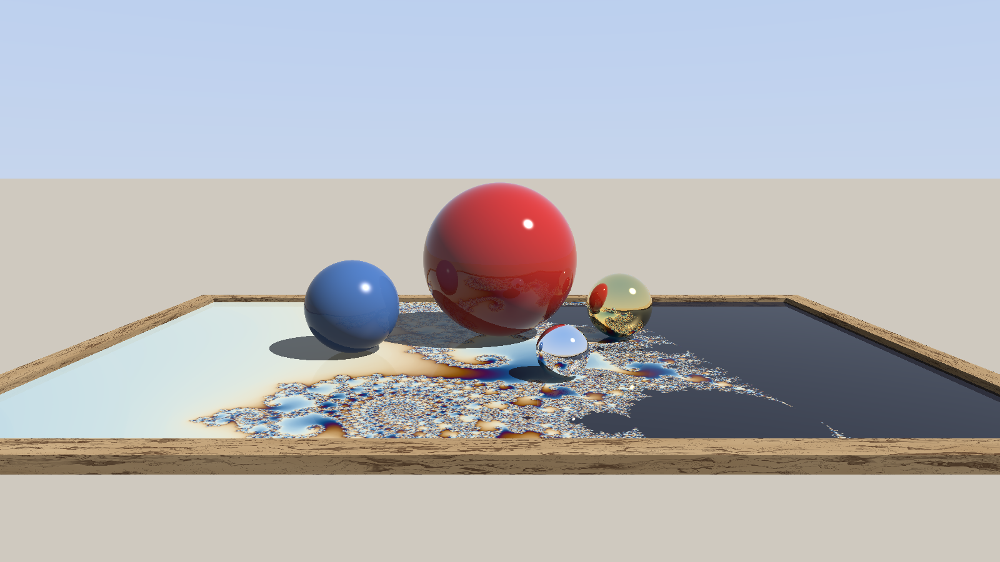

# Kugel-Raytracer



Echtzeit-Raytracer auf der GPU. Ein Compute-Shader wirft pro Pixel einen Strahl: Kugeln, Schatten, Spiegelungen. Ein zweiter Shader zeichnet das Mandelbrot in den Bilderrahmen. Die graue Fläche und der Holzrahmen sind matt.

```
cmake -S . -B build
cmake --build build
./build/kugel-raytracer
```

Pfeil runter rechnet weniger Strahlen, das Bild wird gröber und schneller. Pfeil hoch macht es wieder feiner. Pfeil links und rechts stellt die Sprungtiefe ein: 1 bis 8. Weniger Sprünge beenden die Spiegelungen früher. Die Taste ? schaltet ein Debug-Overlay ein: Bildrate, Tiefe und Pixel pro Strahl. Escape oder Q schließt das Fenster.

Die Konsole läuft über spdlog. Info ist grün, Warnungen sind gelb, Fehler sind rot.

macOS hat kein X11. Dafür liegen MoltenVK und SDL auf dem Rechner:

```
brew install molten-vk sdl2 pkg-config
cmake -S . -B build -DCMAKE_BUILD_TYPE=Release
cmake --build build
./build/kugel-raytracer
```

Ein Standbild:

```
./build/kugel-raytracer --bild bild.ppm 1280 720
```
