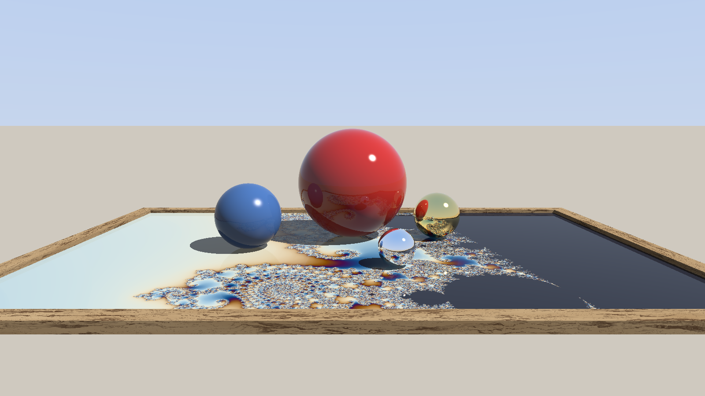

# Kugel-Raytracer



Echtzeit-Raytracer auf der GPU. Ein Compute-Shader wirft pro Pixel einen Strahl: Kugeln, Schatten, Spiegelungen. Ein zweiter Shader zeichnet das Mandelbrot in den Bilderrahmen. Die graue Fläche und der Holzrahmen sind matt.

```
cmake -S . -B build
cmake --build build
./build/kugel-raytracer
```

Pfeil runter rechnet weniger Strahlen, das Bild wird gröber und schneller. Pfeil hoch macht es wieder feiner. Escape oder Q schließt das Fenster.

Ein Standbild:

```
./build/kugel-raytracer --bild bild.ppm 1280 720
```
